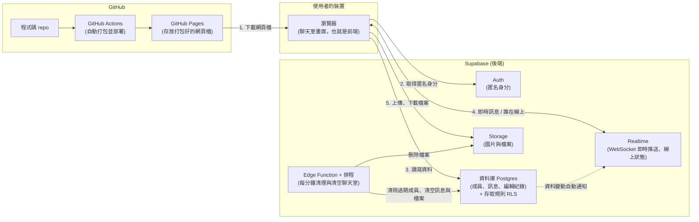
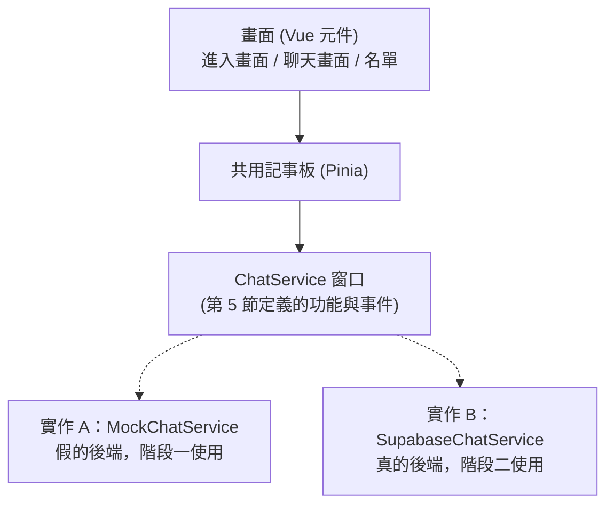
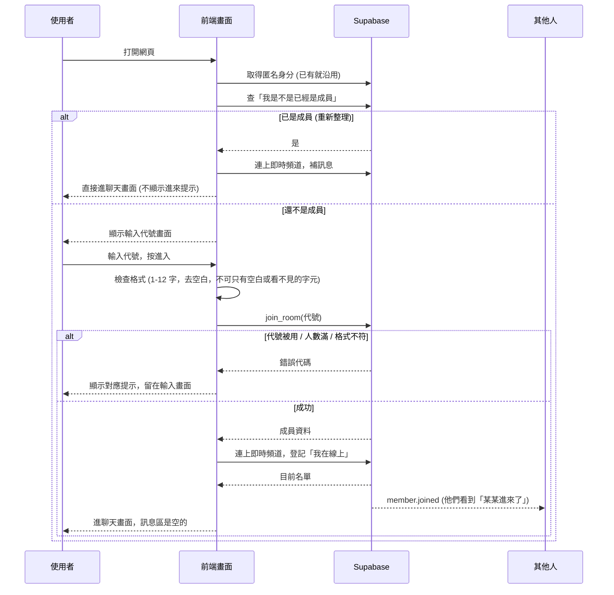
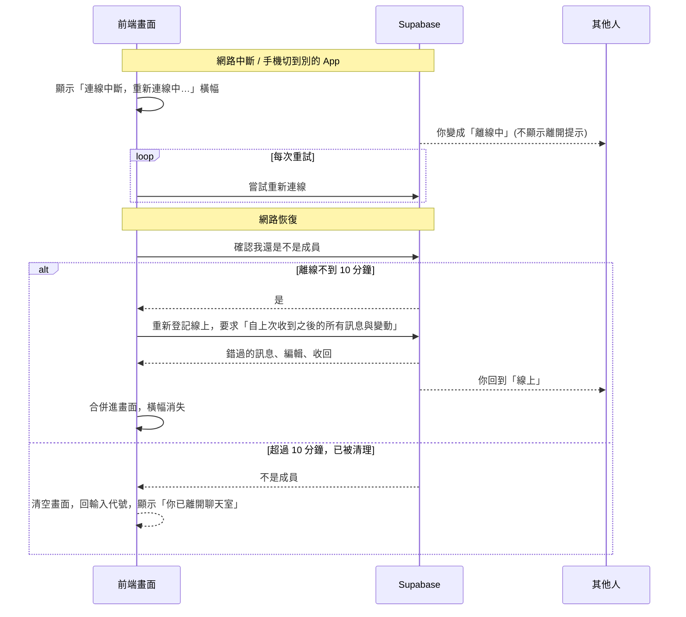

# 匿名聊天室：架構文件

> 這份文件寫給「不寫程式的人」看。第一次出現的專有名詞，會用一句話解釋。
> 需求來源：`docs/requirements.md`，以及之後逐題確認的細節（本文簡稱「訪談結論」）。
> 狀態：階段一（前端 + 假後端）已完成，階段二（接上 Supabase）尚未開始。

---

## 0. 先看這裡：需要你確認的取捨

訪談時你的選擇，有幾處在技術上做不到完全一樣，或我替你補了你沒回答的細節。請先看這一段，不同意的地方告訴我，我再改。

| # | 項目 | 你的選擇／原本期待 | 實際設計 | 為什麼 |
|---|------|------------------|----------|--------|
| 1 | 關掉頁面算離開 | 斷線的人只要頁面沒關就一直保留，關掉頁面才算離開 | **斷線超過 10 分鐘，就視為離開**（代號釋出、其他人看到「某某離開了」）。按「離開」按鈕則立刻離開 | 網站**無法分辨**「使用者關掉頁面」和「使用者手機沒網路」，兩者對伺服器來說都是「連線消失了」。「重新整理」也會觸發關閉頁面的訊號，所以不能靠那個訊號判斷離開。只能用「消失多久」來猜。10 分鐘可以調整 |
| 2 | 回來後補訊息 | 沒有時間限制 | 10 分鐘內回來可以補訊息；超過 10 分鐘，回到輸入代號畫面，並顯示「你已離開聊天室」 | 同上，是 #1 的結果 |
| 3 | 文字訊息長度 | 你沒回答 | 單則上限 **1000 字** | 防止有人貼一大堆字讓畫面卡住 |
| 4 | 網址能不能點 | 你沒回答 | **網址顯示成純文字，不能點**，使用者自己複製 | 匿名環境裡，可點的連結很容易被拿來騙人 |
| 5 | 「全員離開就清空」 | 最後一個人離開時清空 | 最後一人離開後 **1 分鐘內**清空（不是同一秒） | 清空由一個每分鐘跑一次的排程負責，見 3.4 |
| 6 | 同一個瀏覽器開兩個分頁 | 你沒回答 | 視為**同一個人**，兩個分頁都顯示同一個代號 | 系統用瀏覽器裡存的「匿名身分」認人，同一個瀏覽器只有一個身分。要測試「兩個人」請用兩個不同的瀏覽器，或一般視窗加無痕視窗 |
| 7 | 訊息、檔案、編輯歷史的保存 | 新進來的人看不到舊訊息 | 訊息**確實會存在伺服器**直到聊天室清空，但新進來的人被規則擋住，看不到加入前的內容 | 補訊息、收回、編輯歷史都需要先存起來 |
| 8 | 系統提示（某某進來／離開） | 你沒回答 | 提示只在**當下**顯示，不存起來；斷線期間錯過的提示，回來後不補 | 提示不是對話內容，沒必要保存 |
| 9 | 任何檔案都能上傳 | 你選 C | 照做，但檔案**一律當成附件下載**，網頁不會直接執行它；只有 png／jpg／gif／webp 圖片會直接顯示在對話裡 | 見第 9 節。這是你選擇承擔的風險，我把防線盡量做在伺服器上 |
| 10 | 頭像 | 進入前可設定，內建選項與上傳都可以 | 內建：6 種圖案 × 6 種底色；上傳：只收 png／jpg／webp，**瀏覽器先裁成正方形、縮成 256×256 並重新編碼**後才上傳。進入後不能更換，要換請離開再進入 | 重新編碼可以去掉圖片裡夾帶的資料與拍攝位置；不收 gif 與 svg（見第 9 節）。上傳的頭像和聊天室其他檔案一起，在聊天室清空時刪除 |
| 11 | @ 提及 | 你選「訊息特別標示」 | 輸入「@」跳出成員選單挑人；訊息裡的「@代號」變成標籤；被提到的人看到整則訊息多一圈強調色與「提到你」，分頁標題在被 @ 時變成「(@3)」。**不發聲、不跳系統通知、不補送** | 提及只是顯示用的標記；人在聊天室裡才選得到，離開的人不能被 @。見第 5.3、9.1 節 |
| 12 | 回覆 | 你選「和被 @ 一樣標示」 | 對任何一則訊息按「回覆」（電腦滑過、手機長按），輸入區上方出現「回覆 某某：內容」可取消；送出後訊息上方有引用，點一下跳回原訊息。被回覆的人看到「回覆你」小標、玫瑰色外框，分頁在背景時標題的數字前多「@」。只回覆一層（不做串）| 引用的內容由伺服器依原訊息產生；原訊息被收回，引用改成「原訊息已收回」。見第 5.3、9.1 節 |

---

## 1. 專案說明與目標

### 這是什麼
一個**不用註冊、不用登入**的聊天室。任何人拿到網址，輸入一個代號就能加入同一個聊天室，電腦和手機都能用。

### 使用者能做什麼
- 輸入代號進入（1–12 字，代號被線上的人用了就要換一個）
- 在訊息裡用「@」提到某個人，被提到的人會看到特別標示
- 回覆某一則訊息，被回覆的人會看到特別標示
- 進入前先設定頭像：從內建圖案加底色挑選，或上傳自己的圖片（進入後不能再改）
- 看到「誰在線上」，有人進來／離開時有提示
- 送出文字（含 emoji）、圖片、任何檔案（單檔 10MB 以內）
- 編輯、收回自己的訊息
- 隱藏某個人（只有自己看不到他，對方不知道）
- 斷線或重新整理後，自動回到聊天室並補上錯過的訊息
- 按「離開」立刻離開

### 目標
1. **先看得到**：第一階段先把畫面做好，放在 GitHub Pages 上讓你直接點開來看、操作。
2. **後接上線**：第二階段才接 Supabase，讓不同的人真的能互相聊天。
3. **接上時不用重寫畫面**：這是整份設計最重要的原則，見第 4 節。
4. **盡量用免費方案**，所以人數上限設 50 人（見第 9 節）。

### 名詞快速解釋
- **前端**：在使用者瀏覽器裡跑的部分，就是畫面和按鈕。
- **後端**：在遠端伺服器上跑的部分，負責存資料、轉送訊息。這個專案的後端完全交給 Supabase，我們不自己架伺服器。
- **GitHub Pages**：GitHub 提供的免費網頁空間，只能放「靜態網頁」（寫好就不會變的檔案），不能執行後端程式。
- **Supabase**：一個現成的後端服務，提供資料庫、即時通訊、檔案儲存等功能，有免費方案。
- **WebSocket**：瀏覽器和伺服器之間一條「一直保持開著的電話線」，讓伺服器可以隨時主動把新訊息推給你，不用你一直問「有新訊息嗎」。

---

## 2. 整體架構圖



**怎麼讀這張圖：**
- GitHub Pages 只負責「把網頁檔交給瀏覽器」，之後聊天的所有事情，瀏覽器直接跟 Supabase 講話，不經過 GitHub。
- 瀏覽器和 Supabase 之間有好幾條線，是因為 Supabase 其實是好幾個服務打包在一起，每個服務負責一件事（見第 3 節）。
- 第一階段只有左邊兩塊（瀏覽器、GitHub），右邊 Supabase 整塊還沒接，用「假的後端」代替。

---

## 3. 技術選擇

### 3.1 前端

| 項目 | 選了什麼 | 為什麼 |
|------|----------|--------|
| 語言 | **TypeScript**（JavaScript 加上「資料長什麼樣」的型別標註） | 前端一定要用 JavaScript 系的語言。TypeScript 會在寫程式時就檢查「訊息的資料格式有沒有寫錯」，第 5 節的通訊約定可以直接變成程式碼裡的檢查，少很多「接上 Supabase 才發現對不起來」的錯 |
| 框架 | **Vue 3**（幫忙把「資料變了，畫面自動跟著變」這件事處理好的工具包） | 聊天室的本質就是「資料一直在變，畫面要即時跟上」，Vue 很適合；語法接近 HTML，/design 和 /frontend-design 產出的畫面容易放進去；不像 React 需要學很多額外觀念 |
| 打包工具 | **Vite**（把一堆原始碼合併、壓縮成瀏覽器能讀的檔案） | 設定簡單、速度快，Vue 官方推薦，輸出的檔案可以直接放 GitHub Pages |
| 狀態管理 | **Pinia**（Vue 官方的「全班共用的記事板」，存放目前的成員名單、訊息等） | 畫面很多地方要用同一份資料（名單頁、訊息區、標題的未讀數），放在共用記事板最不容易亂 |
| 樣式 | 由 /design 與 /frontend-design 決定，本文不規定 | 你的要求 |

> 為什麼不用「純 HTML + 原生 JavaScript、不用框架」？第一版看起來能做，但編輯／收回／隱藏／斷線補訊息／未讀數同時要更新畫面，沒有框架的話程式很快會變成一團亂線。

### 3.2 Supabase 用哪些功能

| 功能 | 用來做什麼 | 為什麼選它 |
|------|-----------|-----------|
| **Auth 的「匿名登入」** | 使用者不需要輸入帳號密碼，Supabase 會在他的瀏覽器裡自動發一張「匿名通行證」（一串隨機身分碼）。同一個瀏覽器重新整理後還是同一張通行證 | 這就是「認得出同一個人」的方法：重新整理後能自動回到聊天室、只有自己能編輯／收回自己的訊息。**不是登入**，使用者完全無感，也不收集任何個資。**需要在 Supabase 後台手動開啟這個功能** |
| **Database（Postgres 資料庫）** | 存三張表：成員、訊息、編輯紀錄（見 5.3） | 補訊息需要查「錯過了什麼」，只靠即時推送做不到 |
| **Row Level Security（RLS，「每一列資料的存取規則」）** | 規定「誰能看哪些資料、誰能改哪些資料」，例如：新進來的人看不到加入前的訊息、你不能改別人的訊息 | **這是整個專案最重要的安全防線**。因為網頁程式碼是公開的，任何人都能偷看，所以所有規則必須由 Supabase 伺服器強制執行，不能只靠前端 |
| **Realtime 的「Postgres Changes」** | 資料庫裡的訊息或成員有新增／修改／刪除時，自動即時推送給所有人 | 比「自己另外廣播一份」少一個出錯的地方：看到的永遠就是資料庫裡真正存的 |
| **Realtime 的「Presence」** | 追蹤「現在誰的連線還在」，用來顯示「線上」或「離線中」 | 它剛好就是為此設計的，連線一斷會自動更新 |
| **Storage（檔案儲存）** | 存圖片、檔案與上傳的頭像（頭像放獨立的儲存桶），設為「私有」，每次下載都用有時效的簽名連結 | 私有 + 簽名連結，沒登入的外人拿到檔案路徑也下載不到 |
| **Edge Function + pg_cron** | 每分鐘跑一次的清理工作：移除離線過久的成員、聊天室沒人時清空所有訊息和檔案 | 刪檔案需要比一般使用者更高的權限（見第 8 節的「秘密金鑰」），這個權限只能放在 Supabase 伺服器裡，不能放網頁。**Edge Function** 是跑在 Supabase 上的一小段程式，**pg_cron** 是「每隔固定時間叫它起床」的鬧鐘 |

**刻意沒有選的**
- 「Broadcast」（純廣播，不經過資料庫）：速度快，但沒有存檔，無法補訊息。
- 自己架 WebSocket 伺服器：需要付費主機，也要自己維護，與「放 GitHub Pages + 免費方案」的目標衝突。

---

## 4. 兩個階段，以及怎麼避免整個重寫

### 4.1 核心設計：畫面不直接跟 Supabase 講話

畫面（Vue 元件）只跟一個叫 **ChatService（聊天服務）** 的「窗口」講話，這個窗口有固定的一組功能（進入、離開、送文字、送檔案、編輯、收回、補訊息……）和固定的一組通知（有新訊息、有人進來……）。窗口後面有兩種可以互換的實作：



- 畫面和記事板**完全不知道**後面是真是假。
- 用哪一個，由一個設定值決定：`VITE_CHAT_BACKEND=mock` 或 `supabase`。
- 兩種實作都必須遵守第 5 節的同一份約定。**只要約定不變，換實作不需要改畫面。**

### 4.2 階段一：只有前端（還沒接 Supabase）

**前端能做到什麼程度**

| 功能 | 階段一的做法 |
|------|-------------|
| 輸入代號、格式檢查（1–12 字、去前後空白） | 完整，規則寫在前端共用函式，階段二直接沿用 |
| 代號重複提示、人數已滿提示 | 完整，由假後端判斷 |
| 看到訊息、送文字、時間、左右配置 | 完整 |
| 送圖片與檔案（10MB 限制、進度、圖片預覽、檔案卡片） | 完整，檔案暫存在瀏覽器記憶體 |
| 編輯、收回、「已編輯」與歷史版本 | 完整 |
| 線上名單、線上／離線中、隱藏某人 | 完整 |
| 進來／離開提示 | 完整 |
| 斷線橫幅與重連、補訊息 | 用一個「模擬斷線」的開發用按鈕測試（只在階段一出現） |
| 分頁標題未讀數 | 完整 |
| 手機版與電腦版配置 | 完整 |
| **多人互動** | 假後端內建 2–3 個**機器人成員**，會定時說話、進進出退出；另外同一個瀏覽器開多個分頁時，用瀏覽器內建的 BroadcastChannel（「同一個瀏覽器內各分頁之間的對講機」）讓分頁彼此看得到對方，可模擬多人 |
| 資料保存 | 只存在瀏覽器記憶體，關掉頁面就沒有，符合「不留存」 |

**階段一做不到（要等階段二）**
- 不同裝置、不同人真的互相聊天
- 伺服器端的強制規則（RLS）、頻率限制，因為還沒有伺服器
- 真正的「全員離開才清空」

**怎麼在 GitHub Pages 上看到**
推到 GitHub 後，自動打包並發佈，你會得到類似 `https://<你的帳號>.github.io/<repo 名稱>/` 的網址，用電腦和手機都能直接開（部署方式見第 12 節）。

> 階段一的假後端有一個細節跟階段二不同：為了方便你開多個分頁測試，**假後端每個分頁算一個人**；階段二是**每個瀏覽器算一個人**（見第 0 節 #6）。

### 4.3 階段二：接上 Supabase

**需要改的**
1. 新增 `SupabaseChatService`（真的後端實作），遵守同一份約定。
2. 設定值 `VITE_CHAT_BACKEND` 從 `mock` 改為 `supabase`。
3. 在 Supabase 後台：建立專案、開啟匿名登入、執行建表與規則的 SQL、建立 Storage 儲存桶、部署清理用的 Edge Function、設定排程。
4. 把 Supabase 的「專案網址」與「公開金鑰」告訴前端（見第 8 節）。
5. 「模擬斷線」的開發按鈕在正式環境隱藏。

**不用改的**
- 所有畫面與元件
- 共用記事板
- 輸入檢查函式
- 第 5 節的事件與資料格式

### 4.4 為什麼這樣就不用重寫

1. 畫面只依賴「約定」，不依賴任何一種後端。
2. 假後端被刻意要求做出「真實後端會有的行為」：會回傳同樣的錯誤代碼（代號被用、人數已滿、太快送出）、同樣的事件順序、同樣的資料格式。畫面對這些情況的處理，階段一就已經做好、測好。
3. 唯一的差別：階段二的錯誤會多一些「網路慢、真的斷線」的情況，畫面本來就有斷線橫幅，不需新增。

---

## 5. 通訊約定

這一節是整個專案的「合約」。畫面、假後端、真後端都必須遵守。

### 5.1 ChatService 提供的動作（畫面可以叫它做的事）

| 動作 | 說明 | 可能失敗的原因（錯誤代碼） |
|------|------|--------------------------|
| `uploadAvatar(file)` | 進入前上傳自己的頭像圖片，成功後得到一個頭像資料（見 Avatar） | `AVATAR_TYPE_INVALID`、`AVATAR_TOO_LARGE` |
| `join(nickname, avatar)` | 用代號與頭像進入聊天室 | `NICKNAME_INVALID`、`NICKNAME_TAKEN`、`ROOM_FULL`、`AVATAR_INVALID` |
| `resume()` | 重新整理後，嘗試用原本的身分回到聊天室 | `NOT_A_MEMBER`（已被視為離開，需重新輸入代號） |
| `leave()` | 主動離開 | — |
| `sendText(text, options?)` | 送出文字；`options.mentions` 是文字裡用「@」挑出的人（最多 10 位），`options.replyToId` 是要回覆的訊息 id | `MESSAGE_TOO_LONG`、`MESSAGE_EMPTY`、`MENTION_INVALID`、`REPLY_INVALID`、`RATE_LIMITED`、`NOT_A_MEMBER` |
| `sendFile(file, onProgress?, options?)` | 上傳並送出檔案；`options.replyToId` 同上 | `FILE_TOO_LARGE`、`REPLY_INVALID`、`RATE_LIMITED`、`NOT_A_MEMBER` |
| `editMessage(id, newText)` | 編輯自己的文字訊息 | `NOT_OWNER`、`MESSAGE_TOO_LONG`、`MESSAGE_RECALLED` |
| `recallMessage(id)` | 收回自己的訊息或檔案 | `NOT_OWNER` |
| `getEditHistory(id)` | 取得某則訊息的舊版本 | `NOT_A_MEMBER` |
| `getFileUrl(path)` | 取得檔案的暫時下載連結（有時效） | `NOT_A_MEMBER` |
| `loadMessages()` | 取得「我加入之後」的所有訊息（重新整理後回到聊天室時用；加入前的訊息永遠拿不到） | `NOT_A_MEMBER` |
| `catchUp()` | 補上斷線期間錯過的訊息與變動（連線恢復時自動呼叫） | — |

### 5.2 ChatService 發出的事件（畫面會收到的通知）

| 事件名稱 | 什麼時候發出 | 帶的資料 |
|----------|-------------|---------|
| `connection.changed` | 連線狀態改變 | `{ status: "connected" \| "reconnecting" \| "offline" }` |
| `room.snapshot` | 剛進入或重連成功後，給畫面一份目前的完整名單 | `{ members: Member[] }` |
| `member.joined` | 有人進來 | `{ member: Member }` |
| `member.left` | 有人離開（含離線過久被清理） | `{ memberId, nickname }` |
| `member.presence` | 某人的線上狀態改變 | `{ memberId, online: boolean }` |
| `message.created` | 有新訊息 | `{ message: Message }` |
| `message.updated` | 訊息被編輯或收回 | `{ message: Message }` |
| `room.cleared` | 聊天室被清空（只會在你離線期間發生，回來時才發現） | `{}` |
| `session.expired` | 你被視為離開了（離線過久） | `{}` |

### 5.3 資料格式

**Member（成員）**
```json
{
  "id": "b2f1c0de-...",          // 每次「進入」都會產生新的，離開再回來就是新的 id
  "nickname": "小明",
  "avatar": { "kind": "preset", "icon": "star", "color": "blue" },
  "online": true,                // true=線上，false=離線中
  "joinedAt": "2026-10-27T06:12:03Z"
}
```
> 「隱藏某人」記的是這個 `id`，不是代號。所以對方離開再回來（拿到新的 id）就不再被隱藏，符合你的選擇。

**Mention（提及）**
```json
{ "memberId": "c9d2...", "nickname": "Bee" }
```
- 文字裡照樣寫著「@Bee」；`mentions` 記下這是「哪一位」（用成員 id，因為代號之後可能被別人使用）。
- 伺服器會再確認：被 @ 的人此刻真的在聊天室、文字裡真的寫著對應的「@代號」、一則最多 10 位；代號以伺服器上的為準。不合的提及會被丟掉，文字本身照常送出。
- 只有從選單挑出來的人才算提及；手打「@Bee」只是普通文字。編輯訊息時，文字裡還留著的提及會保留，編輯模式裡不能新增。
- 收回訊息時，提及一併清空。

**ReplyRef（回覆的引用）**
```json
{ "messageId": "9a7e...", "memberId": "b2f1...", "nickname": "Amy", "kind": "text", "preview": "今晚吃什麼？" }
```
- `kind` 是 `text`、`image` 或 `file`；`preview` 在文字時是前 80 字（換行縮成空格），在圖片與檔案時是檔名。
- 畫面只傳 `replyToId`；引用的內容由**伺服器依真正的原訊息產生**，不信任畫面傳來的。原訊息必須是「我看得到、還沒收回」的訊息，否則回 `REPLY_INVALID`。
- 顯示時優先用聊天室裡「現在」的原訊息：被編輯過就顯示最新內容；被收回就顯示「原訊息已收回」；原訊息的作者被你隱藏，就顯示「回覆已隱藏的人的訊息」，不洩漏內容。
- 只回覆一層：回覆「一則回覆」時，引用的是那一則本身，不會連到更早的訊息。
- 自己的回覆被收回時，引用一併清掉。

**Avatar（頭像）**——兩種形式擇一
```json
{ "kind": "preset", "icon": "star", "color": "blue" }
{ "kind": "upload", "path": "avatars/3f2c1b9e-.../a81c...webp" }
```
- `icon` 只能是 `star`、`moon`、`leaf`、`flame`、`heart`、`cloud`；`color` 只能是 `blue`、`green`、`orange`、`pink`、`purple`、`teal`。
- 上傳的頭像會先在瀏覽器裡處理：從中間裁成正方形、縮到 256×256、轉成 webp 重新編碼，結果通常不到 100KB。原圖上限 5MB，處理後上限 200KB。
- 資料庫另外檢查：`path` 必須是呼叫者自己資料夾下的檔案；`icon`、`color` 必須在上面的清單內。

**Message（訊息）**——文字與檔案共用一個格式
```json
{
  "id": "9a7e...",
  "memberId": "b2f1c0de-...",
  "nickname": "小明",            // 送出時的代號快照，即使對方離開也還在
  "avatar": { "kind": "preset", "icon": "star", "color": "blue" },  // 送出時的頭像快照
  "kind": "text",                // "text" 或 "file"
  "text": "大家好 @Bee",         // kind=file 時為 null
  "mentions": [{ "memberId": "c9d2...", "nickname": "Bee" }],  // 沒有 @ 任何人時是 []
  "replyTo": null,               // 回覆別人時是下面的 ReplyRef
  "file": null,                  // kind=text 時為 null
  "createdAt": "2026-10-27T06:13:00Z",
  "updatedAt": "2026-10-27T06:13:00Z",
  "edited": false,
  "recalled": false              // true 時 text 與 file 都會被清成 null
}
```

**File（檔案資訊，放在 Message.file 裡）**
```json
{
  "path": "9a7e.../3f2c1b9e-....bin",  // 儲存路徑，用隨機碼命名，不用使用者的檔名
  "name": "報告.pdf",                  // 顯示用的原始檔名（已清理）
  "size": 2048576,                     // bytes
  "mime": "application/pdf",
  "isImage": false                     // 只有 png/jpg/gif/webp 為 true，才會直接顯示在對話裡
}
```

**EditRecord（編輯歷史）**
```json
{ "messageId": "9a7e...", "oldText": "大傢好", "editedAt": "2026-10-27T06:14:10Z" }
```

**錯誤**
```json
{ "code": "NICKNAME_TAKEN", "message": "這個代號已有人使用，請換一個" }
```

### 5.4 對應到 Supabase 的資料表

| 表 | 欄位 | 說明 |
|----|------|------|
| `members` | `id`、`user_id`（匿名身分碼）、`nickname`、`avatar`（上面的頭像格式，整包存成一欄）、`joined_at`、`last_seen` | `nickname` 不分大小寫唯一，這是「代號不能重複」的最後防線；`last_seen` 用來判斷離線過久 |
| `messages` | `id`、`member_id`、`nickname`、`avatar`、`mentions`、`reply_to`（上面的 ReplyRef，整包存成一欄）、`kind`、`text`、`file_*`、`created_at`、`updated_at`、`edited`、`recalled` | `updated_at` 用來「補上斷線期間的變動」 |
| `message_edits` | `message_id`、`old_text`、`edited_at` | 收回時一併刪掉 |

動作大多做成 Supabase 的「函式」（資料庫裡的小程式，所有檢查在裡面一次做完）：`join_room`、`leave_room`、`touch_member`（心跳）、`edit_message`、`recall_message`。送出訊息則是直接寫入 `messages`，由存取規則與觸發器把關。

---

## 6. 資料流

### 6.1 進入聊天室


重點：新成員只看得到「加入時間之後」的訊息，由資料庫存取規則強制執行（不是前端隱藏）。

頭像的時機：如果使用者選擇上傳圖片，上傳發生在按「進入」**之前**（在進入畫面裡就先處理並上傳，成功後預覽才換成他的圖片）；按「進入」時，只是把頭像資料連同代號一起交給 `join_room`。因此上傳頭像用的是進入前就取得的匿名身分。這代表有人可以只上傳頭像、不進入聊天室，所以頭像儲存桶有大小與格式限制，沒進入的人上傳的頭像會在聊天室清空時一起被刪除。

### 6.2 送出訊息

1. 使用者輸入文字按送出（檔案則先上傳到 Storage，成功後才送出訊息）。
2. 前端先檢查：不是空白、不超過 1000 字、檔案不超過 10MB。
3. 前端立刻在畫面上顯示一則「送出中」的訊息，讓使用者覺得很快。
4. 寫入資料庫。資料庫檢查：你是成員、距離上一則至少 1 秒、長度合格。
5. 通過後，Supabase 把這則訊息推送給所有人（包括你自己，你的「送出中」換成正式版本）。
6. 失敗時，那則訊息標示「送出失敗」，旁邊有「重試」。

編輯：只能編輯自己的文字訊息。資料庫先把舊內容存進 `message_edits`，再改新內容、標記已編輯，並推送更新。
收回：資料庫把內容與檔案資訊清空、標記已收回、刪除編輯歷史；前端同時刪除 Storage 裡的檔案。若檔案刪除失敗，會留到聊天室清空時再清掉。

### 6.3 離開

**主動離開（按離開按鈕）**
1. 跳出確認「確定要離開嗎？」
2. 呼叫 `leave_room`，資料庫刪除你的成員資料。
3. 其他人收到 `member.left`，看到「某某離開了」。
4. 你回到輸入代號畫面，並清掉本機的隱藏名單。代號立刻可被別人使用。

**直接關掉頁面**
- 前端什麼都來不及做。伺服器發現你的連線消失，名單上變成「離線中」。
- 超過 10 分鐘沒有任何心跳，清理排程把你視為離開（等同主動離開，但有最多約 1 分鐘的延遲）。

### 6.4 斷線與重連


補訊息的依據是「我最後收到的訊息的 `updatedAt`」（用伺服器時間，不用手機時間，避免手機時鐘不準）。

### 6.5 聊天室清空

- 每分鐘排程檢查：先移除 `last_seen` 超過 10 分鐘的成員；若此時成員數為 0，刪除所有訊息、編輯紀錄與 Storage 檔案。
- 因此「最後一人離開 → 清空」最多延遲約 1 分鐘（見第 0 節 #5）。
- 在這 1 分鐘內如果有新的人加入，因為存取規則「只能看到加入後的訊息」，他仍然看不到舊內容；清空時才一併刪除。

---

## 7. 畫面清單

這裡只寫「有什麼元素、按了會怎樣」，不規定顏色與樣式。

### 7.1 進入畫面
| 元素 | 行為 |
|------|------|
| 標題與一句簡介 | 純說明 |
| 頭像預覽 | 顯示目前選的頭像（圓形，較大） |
| 內建圖案列 | 6 個圖案可選，一次選一個；選中的有明顯外框；點擊範圍至少 44px |
| 底色列 | 6 種底色可選，一次選一個；預設是藍色星星 |
| 「上傳圖片」按鈕 | 開啟選擇圖片；只接受 png、jpg、webp，原圖 5MB 以內；選好後顯示「圖片處理中…」，處理完預覽換成上傳的圖片 |
| 已上傳時的狀態 | 內建圖案列與底色列暫時停用；出現「更換圖片」與「移除，改用內建圖案」 |
| 頭像錯誤提示 | 格式不對 →「只能使用 png、jpg、webp 圖片」；太大 →「圖片不能超過 5MB」 |
| 代號輸入框 | 即時顯示目前字數（x/12）；自動去前後空白；按 Enter 等同按進入 |
| 「進入」按鈕 | 格式不合時不能按；按下後顯示載入中、按鈕暫時停用 |
| 錯誤提示區 | `NICKNAME_TAKEN` →「這個代號已有人使用，請換一個」；`ROOM_FULL` →「聊天室已滿（50 人），請稍後再試」；`NICKNAME_INVALID` → 說明規則；`session.expired` →「你已離開聊天室，請重新輸入代號」 |

### 7.2 聊天畫面（電腦：訊息區加右側名單；手機：只有訊息區）

**頂部列**
| 元素 | 行為 |
|------|------|
| 聊天室名稱 | 純顯示 |
| 在線人數「N 人在線」 | 計算「線上」的人，不含「離線中」 |
| 連線狀態 | 正常時不顯示；斷線時顯示橫幅「連線中斷，重新連線中…」，恢復後自動消失 |
| 名單按鈕（僅手機） | 切換到名單頁 |
| 「離開」按鈕 | 先跳確認視窗，確認後離開 |

**訊息區**
| 元素 | 行為 |
|------|------|
| 文字訊息 | 自己的靠右、別人的靠左；別人的訊息在代號旁顯示小頭像；顯示代號（別人的）、送出時間（`HH:mm`，使用者的當地時間）；網址是純文字 |
| 提及標籤 | 訊息裡被 @ 的「@代號」顯示成有底色的小標籤；如果被提到的是你，標籤用強調色 |
| 回覆的引用 | 回覆別人的訊息上方，有一小塊引用：回覆圖示、被回覆的人的代號、內容前兩行（圖片與檔案顯示圖示與檔名）。點一下捲到原訊息並閃一下；原訊息已收回時顯示「回覆 某某：原訊息已收回」，不能點 |
| 「回覆你」 | 有人回覆你的訊息時，那則訊息的代號旁多「回覆你」小標，氣泡外面多一圈強調色（和「提到你」同一套，兩者可同時出現） |
| 「提到你」 | 有人 @ 你時，那則訊息的代號旁多一個「提到你」小標，氣泡外面多一圈強調色（自己 @ 自己不會有） |
| 圖片訊息 | 直接顯示縮圖；點一下開大圖視窗 |
| 檔案訊息 | 顯示檔案卡片：檔名、大小、「下載」按鈕，旁邊提示「下載前請確認來源」 |
| 「已編輯」標記 | 顯示在編輯過的訊息正下方；點一下，就在該訊息下方展開修改前的版本清單（不是跳出視窗），再點一下收合 |
| 「這則訊息已收回」 | 收回後取代原內容；時間與代號仍保留 |
| 系統提示 | 「某某進來了」「某某離開了」，置中、與一般訊息區分；只在當下出現 |
| 訊息操作選單 | 只有**自己的**訊息有：文字可「編輯」「收回」，檔案只有「收回」。電腦用滑鼠移上去，手機用長按 |
| 編輯模式 | 原訊息變成輸入框，有「儲存」「取消」 |
| 自動捲動 | 你在最底部時，新訊息自動捲到底；你在往上看舊訊息時不自動捲，改在底部出現「有 N 則新訊息」按鈕，點了捲到底 |
| 空狀態 | 剛進來沒訊息時顯示「還沒有訊息，說點什麼吧」 |
| 被隱藏的人的訊息 | 完全不顯示（取消隱藏就會回來） |

**輸入區**
| 元素 | 行為 |
|------|------|
| 文字輸入框 | 電腦：Enter 送出、Shift+Enter 換行；手機：Enter 換行，用按鈕送出；超過 1000 字時顯示字數並禁止送出 |
| 送出按鈕 | 沒內容時不能按；送出後頻率限制時短暫停用 |
| 附件按鈕 | 開啟選擇檔案；選好後顯示預覽（圖片縮圖或檔名）、上傳進度、取消；超過 10MB 顯示「檔案不能超過 10MB」 |
| 回覆列 | 按了「回覆」之後，輸入區上方出現「回覆 某某：內容」與取消鈕，輸入框自動取得焦點；按 Esc 或取消鈕可取消；送出（文字或檔案）後自動消失；回覆中的原訊息被收回，回覆列自動消失 |
| 操作選單／工具列 | 每一則（非收回、非送出中）訊息都有「回覆」；自己的訊息另有「編輯」「收回」。電腦滑過顯示工具列，手機長按顯示選單 |
| @ 成員選單 | 在空白或行首輸入「@」就跳出選單（輸入框上方），列出可被提到的成員（不含自己，線上的排前面）；繼續打字會縮小範圍；↑↓ 選擇、Enter 或 Tab 確定、Esc 關閉；也可以直接點選。選好後輸入框裡插入「@代號 」。信箱格式（a@b.com）不會觸發 |
| 送出失敗提示 | 訊息旁顯示「送出失敗，點此重試」 |
| 斷線時 | 輸入框仍可打字，但送出按鈕停用，並提示「連線恢復後才能送出」 |

### 7.3 名單（電腦：右側固定；手機：獨立頁面）
| 元素 | 行為 |
|------|------|
| 成員列 | 頭像、代號、狀態（線上／離線中）；自己標「你」；被自己隱藏的人，頭像換成「隱藏」圖示 |
| 「隱藏」／「取消隱藏」 | 每個**別人**旁邊都有。隱藏後該人的訊息與檔案從畫面消失，他的列顯示「已隱藏」 |
| 人數 | 「N / 50」 |
| 返回按鈕（僅手機） | 回到訊息區 |

### 7.4 對話框與浮層
- 離開確認
- 圖片大圖檢視
- 檔案過大／不允許時的提示

### 7.5 分頁標題
- 視窗在背景時，新訊息會讓標題變成「(3) 匿名聊天室」，回到視窗就清掉，**不發聲音、不跳系統通知**。
- 如果其中有人 @ 你、或回覆你的訊息，數字前面多一個「@」，例如「(@3) 匿名聊天室」。

---

## 8. 金鑰

「金鑰」就是一串程式用來向 Supabase 證明身分的長密碼。這個專案會碰到的有這些：

| 名稱 | 是什麼 | 怎麼取得 | 放哪裡 | 能不能公開 |
|------|--------|----------|--------|-----------|
| **專案網址** | 你的 Supabase 專案的地址（`https://xxxx.supabase.co`） | 建立專案後後台就會顯示 | 前端設定（打包時寫進網頁） | ✅ 可以公開 |
| **公開金鑰**（Supabase 新版叫 *publishable key*，舊版叫 *anon key*） | 網頁用來向 Supabase 打招呼的鑰匙。**它的權限被存取規則（RLS）限制得很死**，只能做規則允許的事 | 後台的專案設定，API 金鑰頁面（實際選單名稱以當時畫面為準） | 前端設定 | ✅ 設計上就是公開的，會出現在網頁原始碼裡，沒辦法也不需要藏。**前提是存取規則一定要開** |
| **秘密金鑰**（新版叫 *secret key*，舊版叫 *service_role key*） | 萬能鑰匙，**可以無視所有存取規則**讀寫所有資料 | 同一個後台頁面 | 只放在 Supabase 的 Edge Function 裡（Supabase 會自動提供給它，我們不需要自己貼） | ❌ **絕對不能公開**，不能進 repo、不能進前端、不能貼給別人或貼進聊天 |
| **資料庫密碼** | 建立專案時你設定的那組密碼 | 你自己設 | 存在你的密碼管理工具 | ❌ 絕對不能公開 |
| **Supabase 存取權杖**（如果用命令列工具部署時需要） | 讓你的電腦代表你操作 Supabase 後台 | 後台的帳號設定 | 只放在你的電腦，不放 repo | ❌ 絕對不能公開 |
| **GitHub 部署權限** | 讓 GitHub Actions 把網頁發佈到 Pages | GitHub 自動提供，不需要自己建立 | — | — |

### 前端要用的兩個值怎麼進入網頁
1. 本機開發：放在 `.env.local` 檔案（不進 repo）。
2. 正式部署：放在 GitHub 專案設定的 **Actions Variables**（GitHub 專案裡存設定值的地方），打包時由 GitHub Actions 帶入。
3. repo 裡放一個 `.env.example`，只有欄位名稱沒有真值，讓人知道要填什麼。

> 因為專案網址與公開金鑰本來就是公開的，放 Variables 還是放 Secrets 都不影響安全；真正的安全靠資料庫的存取規則。

### 避免金鑰被 commit 到 GitHub
- `.gitignore` 忽略 `.env`、`.env.local`、`.env.*.local`（`.env.example` 除外）。
- 程式碼裡不寫任何 `service_role`／secret key 字樣；前端的建置設定只接受以 `VITE_` 開頭的值，且我會檢查沒有任何秘密金鑰用這個前綴。
- 在 GitHub 開啟 **Secret scanning 與 Push protection**（GitHub 內建的「推送前自動檢查有沒有金鑰」功能），公開 repo 免費。
- 萬一不小心外洩：到 Supabase 後台**重新產生**該金鑰（舊的立刻作廢），再更新 Edge Function 與設定值。從 git 歷史刪除不夠，因為外洩的瞬間就視為已被抄走。

---

## 9. 安全與限制

### 9.1 別人可能送什麼奇怪的東西進來

**原則：前端的檢查只是為了讓正常使用者好用；真正的把關一定在 Supabase 伺服器上。** 因為壞人可以完全不用我們的網頁，直接對 Supabase 發請求。

| 可能的攻擊或亂入 | 前端怎麼擋（體驗） | 伺服器怎麼擋（真正防線） |
|-----------------|-------------------|------------------------|
| 在代號或訊息裡塞 HTML／指令碼（XSS，讓別人瀏覽器執行惡意程式） | 所有使用者內容一律當**純文字**顯示，不使用「直接輸出 HTML」的功能 | 同左（顯示是前端的事，這是唯一能擋的地方，所以規定寫死） |
| 回覆一則不存在、已收回、或我根本看不到（加入前）的訊息，藉此偷看內容 | 只能從畫面上看得到的訊息按「回覆」 | 伺服器依 `replyToId` 重新查原訊息，必須存在、未收回、且發生在我加入之後，否則 `REPLY_INVALID`；引用的內容由伺服器產生 |
| 假造「@」：@ 不在聊天室的人、@ 一大串人洗版、讓訊息看起來提到了別人 | 一則最多選 10 位；只有選單挑出的人才算提及 | 伺服器重新驗證：被 @ 的 id 必須是此刻的成員、文字裡必須真的寫著「@代號」、最多 10 位，不合的提及被丟掉；標籤只用文字節點顯示（不產生 HTML）；沒有任何推播，所以不會因為被 @ 而被騷擾通知 |
| 假冒別人的代號（看起來一樣的字、隱形字元、改變閱讀方向的特殊字元） | 輸入時過濾 | `join_room` 拒絕控制字元、零寬字元、方向控制字元；代號比對不分大小寫 |
| 上傳的「頭像」其實是惡意檔案、超大檔、動畫或 svg（可夾帶程式） | 只允許 png／jpg／webp；先在瀏覽器裡用繪圖功能重新畫成 256×256 的 webp 再上傳，等於把原檔洗過一遍，內容裡夾帶的東西與拍攝位置資料都不會留下；頭像一律以圖片方式顯示，不可點、不可下載 | 頭像儲存桶限制：類型只收 png／jpeg／webp，單檔上限 512KB；檔名用隨機碼，不用使用者的檔名；`join_room` 檢查頭像路徑屬於呼叫者本人。注意：沒有內容審查，不當圖片當頭像時只能靠「隱藏」 |
| 假裝是別人送訊息／修改別人的訊息 | — | 存取規則確認 `member_id` 屬於呼叫者的匿名身分 |
| 超長訊息 | 超過 1000 字不能送 | 資料表有長度限制 |
| 洗版（狂送） | 送出後短暫停用按鈕 | 觸發器：同一成員 1 秒內只能寫入一則 |
| 超大檔案 | 超過 10MB 不上傳 | Storage 儲存桶本身設定 10MB 上限 |
| 惡意檔案（病毒、偽裝成圖片的檔案） | 非圖片檔案一律以「檔案卡片」呈現，旁邊提示「下載前請確認來源」 | 檔案一律以**附件下載**方式提供（瀏覽器不會直接執行）；儲存路徑用隨機碼命名；只有 png／jpg／gif／webp 會內嵌顯示，**SVG 圖檔不內嵌**（它可以夾帶程式）。**我們沒有病毒掃描**，這是接受「任何檔案」的代價 |
| 檔名惡搞（`../../`、很長、含特殊字元） | 顯示前清理 | 檔案實際存放路徑完全不用使用者的檔名 |
| 用機器人大量建立匿名身分，把 50 個名額佔滿 | — | Supabase 對匿名登入有每小時次數限制（依 IP）。可選：開啟 CAPTCHA（人機驗證）。第一版先不開，見第 10 節 |
| 非成員直接讀訊息／下載檔案 | — | 存取規則：只有成員能讀；Storage 為私有，只有簽名連結能下載，連結約幾分鐘後失效 |
| 偷看加入前的訊息 | — | 存取規則：只回傳 `created_at >= 自己的加入時間` 的訊息 |

### 9.2 免費方案要注意的上限

> 下面的數字是我撰寫時的了解，Supabase 常調整方案內容。**實作前請對照 Supabase 官方定價頁面確認。**

| 項目 | 大約限制 | 對這個專案的影響 |
|------|---------|----------------|
| **閒置自動暫停** | 免費專案一段時間（約一週）沒人使用會被暫停 | 暫停後聊天室打不開，要到後台手動恢復。這是最容易遇到的狀況 |
| 同時連線數（Realtime） | 約 200 | 人數上限 50 綽綽有餘 |
| 資料庫大小 | 約 500MB | 文字訊息遠遠用不完，且會定期清空 |
| 檔案儲存空間 | 約 1GB | 檔案是主要壓力來源。10MB × 50 人就可能超過，所以才要「全員離開就清空」 |
| 單一檔案上限 | 帳號層級也有上限（約 50MB） | 我們自設 10MB，比它低 |
| 流量（egress） | 每月約 5GB | 大家下載檔案會消耗，多人反覆下載大檔會逼近 |
| 匿名登入次數 | 依 IP 每小時有限制 | 同一個網路下很多人同時進來時，可能暫時進不來 |
| Edge Function 呼叫 | 每月數十萬次 | 每分鐘一次約 4 萬多次，足夠 |

超過上限時的後果多半是「暫時無法使用」，不是「被收費」，但請實作前確認。

---

## 10. 這一版刻意不做的事

| 不做 | 為什麼 |
|------|--------|
| 登入、註冊、個人資料 | 需求就是匿名 |
| 新進來的人看舊訊息、搜尋歷史 | 你選擇「不留存」 |
| 管理員、踢人、封鎖、檢舉 | 你選擇只做「自己隱藏」 |
| 私訊、多個聊天室、頻道 | 需求是「所有人在同一個聊天室」 |
| 表情回應 | 先做核心功能 |
| 回覆串（多層、展開整串對話）、回覆時一併 @ 對方 | 你要的是單層回覆；多層會讓版面和資料都複雜很多 |
| @所有人、@某個群組 | 你要的是「提到某個人」；@所有人在匿名聊天室裡容易被拿來騷擾 |
| 編輯訊息時新增 @、被 @ 的人收到系統通知或聲音 | 你選的是「訊息特別標示」，不打擾；之後想加再加 |
| 「對方正在輸入…」 | 增加大量即時流量，與免費額度衝突，價值有限 |
| 聲音提示、瀏覽器系統通知 | 你選擇只改標題 |
| 可點的連結、連結預覽 | 匿名環境的安全考量 |
| 檔案病毒掃描 | 免費方案做不到；以強制下載與警語降低風險 |
| 內容審查（自動過濾髒話、不當圖片） | 同上，且需要付費服務 |
| 人機驗證（CAPTCHA） | 增加進入的麻煩。若之後被機器人洗，這是第一個要補的 |
| 多語系 | 只做繁體中文 |
| 把「被隱藏的人」同步到其他裝置 | 隱藏只存在這個瀏覽器 |
| 進入後更換頭像 | 你說的是「進入前的設定」。更換會讓過去訊息的頭像前後不一致，要換就離開再進入 |
| 頭像手動裁切、縮放、旋轉 | 第一版固定從中間裁成正方形，不做編輯器 |
| 動態頭像（gif）、svg 頭像 | 動畫會增加流量，svg 可夾帶程式，有安全疑慮 |
| 離線時排隊、等連線後自動補送 | 斷線時送出按鈕直接停用，避免訊息順序錯亂 |

---

## 11. Repo 資料夾結構

```
chat/
├─ docs/
│  ├─ requirements.md            需求說明
│  └─ architecture.md            本文件
├─ src/                          前端程式
│  ├─ main.ts                    程式起點
│  ├─ App.vue                    根畫面：決定顯示「進入畫面」或「聊天畫面」
│  ├─ screens/
│  │  ├─ JoinScreen.vue          進入畫面
│  │  ├─ ChatScreen.vue          聊天畫面
│  │  └─ MembersScreen.vue       手機版名單頁
│  ├─ components/
│  │  ├─ MessageList.vue         訊息區
│  │  ├─ MessageItem.vue         單則訊息
│  │  ├─ MessageInput.vue        輸入區
│  │  ├─ MemberList.vue          名單
│  │  ├─ MentionPicker.vue       輸入「@」後跳出的成員選單
│  │  ├─ AvatarPicker.vue        進入畫面的頭像設定（內建圖案、底色、上傳）
│  │  ├─ AvatarBadge.vue         顯示頭像（訊息旁、名單裡共用）
│  │  ├─ FileCard.vue            檔案卡片
│  │  ├─ ImageViewer.vue         圖片大圖
│  │  ├─ EditHistory.vue         訊息下方展開的編輯歷史
│  │  ├─ ConnectionBanner.vue    斷線橫幅
│  │  ├─ ConfirmDialog.vue       離開確認對話框
│  │  ├─ Icon.vue                線條圖示
│  │  └─ DevPanel.vue            階段一專用測試工具（只有假後端才顯示）
│  ├─ composables/
│  │  ├─ useFileUrl.ts           取得檔案／頭像的暫時連結
│  │  └─ useIsDesktop.ts         判斷電腦版或手機版
│  ├─ styles/
│  │  ├─ tokens.css              設計變數（顏色、尺寸）
│  │  └─ base.css                全站基本樣式
│  ├─ services/
│  │  ├─ chatService.ts          窗口定義：第 5 節的動作、事件、資料格式
│  │  ├─ mockChatService.ts      階段一：假後端
│  │  ├─ supabaseChatService.ts  階段二：真後端
│  │  └─ index.ts                依設定值決定使用哪一個
│  ├─ stores/
│  │  └─ chat.ts                 共用記事板
│  └─ utils/
│     ├─ validate.ts             代號、訊息、檔案的檢查規則（前後端共用規格）
│     ├─ mention.ts              @ 的偵測、切分與整理
│     ├─ reply.ts                回覆引用的整理（預覽文字、檔名）
│     ├─ avatar.ts               頭像的裁切、縮小、重新編碼與檢查
│     └─ format.ts               時間、檔案大小的顯示格式
├─ supabase/                     階段二才會用到
│  ├─ migrations/                建表、存取規則、函式的 SQL（依順序）
│  └─ functions/
│     └─ cleanup-room/           每分鐘執行的清理程式
├─ .github/
│  └─ workflows/
│     └─ deploy.yml              自動打包並部署到 GitHub Pages
├─ index.html
├─ vite.config.ts                打包設定（含 GitHub Pages 的網址前綴）
├─ package.json                  專案用到的套件清單
├─ .env.example                  設定值範本（沒有真值）
└─ .gitignore                    不進 git 的檔案（含 .env.local）
```

---

## 12. 部署到 GitHub Pages

**一次性設定**
1. 在 GitHub 專案的 Settings → Pages，把 Source 選為 **GitHub Actions**。
2. 階段二才需要：在 Settings → Secrets and variables → Actions → Variables 填入兩個值（專案網址、公開金鑰）。
3. 開啟 Secret scanning 與 Push protection（見第 8 節）。

**之後每次更新**
1. 把修改推到 `main` 分支。
2. GitHub Actions 自動：安裝套件 → 打包 → 上傳 → 發佈到 Pages，約 1–2 分鐘。
3. 網址：`https://<帳號>.github.io/<repo 名稱>/`。

**要注意的一個坑**
- GitHub Pages 網址包含 repo 名稱，所以 `vite.config.ts` 的 `base` 必須設為 `/<repo 名稱>/`，否則打開是空白頁。
- 單頁應用不使用網址路由（只有一個頁面，進入／聊天只是畫面切換），所以不會碰到「重新整理出現 404」的問題。
- 階段一與階段二用同一條部署流程，差別只是設定值。

---

## 13. 驗證清單

### 階段一（假後端）：全部打勾才算完成
**進入**
- [ ] 打開網址看得到進入畫面，電腦與手機都能操作
- [ ] 代號空白、全空白、超過 12 字，都不能進入，並有提示
- [ ] 前後多餘空白會被去掉
- [ ] 輸入已被機器人使用的代號，顯示「已有人使用」
- [ ] 把人數填滿到 50（機器人），第 51 個人看到「聊天室已滿」
- [ ] 進入後訊息區是空的
- [ ] 頭像：預設是藍色星星；換圖案、換底色，預覽立刻跟著變
- [ ] 頭像：上傳 png／jpg／webp 成功，預覽變成圓形的圖片；上傳 gif、svg、pdf 被擋並提示
- [ ] 頭像：上傳超過 5MB 的圖被擋；上傳後按「移除」回到內建圖案
- [ ] 頭像：進入後，自己和別人的訊息旁、名單裡都看得到正確頭像
- [ ] @：輸入「@」跳出選單，打字縮小範圍，↑↓、Enter、Tab、Esc、滑鼠點選都能用
- [ ] @：輸入中文選字時按 Enter 不會誤選成員或誤送出
- [ ] @：選好後訊息裡的「@代號」是標籤；手打的「@代號」只是普通文字；信箱格式不觸發選單
- [ ] @：被提到的人看到「提到你」與強調色，沒被提到的人看不到；分頁在背景時標題出現「(@n)」
- [ ] @：同時 @ 超過 10 人時被擋並提示；收回訊息後提及消失
- [ ] 回覆：滑過（電腦）或長按（手機）任何一則訊息都有「回覆」；按下後輸入區出現回覆列，取消鈕與 Esc 都能取消
- [ ] 回覆：送出後訊息上方有引用，點一下捲到原訊息並閃一下；回覆圖片與檔案時引用顯示圖示與檔名
- [ ] 回覆：被回覆的人看到「回覆你」與強調色外框，分頁在背景時標題數字前有「@」；別人看不到這些標示
- [ ] 回覆：原訊息被收回後，引用變成「原訊息已收回」；回覆中的原訊息被收回，回覆列自動消失
- [ ] 回覆：隱藏某人後，別人對他的回覆，引用改成「回覆已隱藏的人的訊息」

**訊息**
- [ ] 送出文字，自己的靠右、有時間；機器人的靠左、有代號
- [ ] 超過 1000 字不能送出
- [ ] 快速連按送出，會被限制（顯示提示）
- [ ] 貼入網址只顯示純文字，不能點
- [ ] 貼入 `<script>`、`<b>粗體</b>` 等內容，原樣顯示成文字，不會被執行
- [ ] 選圖片：顯示預覽，送出後在對話裡顯示，點開看大圖
- [ ] 選非圖片檔案：顯示檔案卡片與下載按鈕與警語
- [ ] 選超過 10MB 檔案：被擋並提示
- [ ] 編輯自己的訊息：顯示「已編輯」，點開看到舊版本
- [ ] 收回文字與收回檔案：顯示「這則訊息已收回」，別人的訊息沒有編輯／收回選項
- [ ] 往上捲動時來新訊息，不會被拉到底，並出現「有 N 則新訊息」

**名單與提示**
- [ ] 機器人進來、離開時有提示
- [ ] 名單顯示線上與「離線中」，且「N 人在線」數字正確
- [ ] 隱藏某人：其訊息消失、取消隱藏後回來；重新整理後隱藏仍有效
- [ ] 按「離開」有確認，離開後回到輸入畫面

**斷線與重新整理**
- [ ] 重新整理後自動回到聊天室，不顯示重複的「進來」提示
- [ ] 用模擬斷線按鈕：出現橫幅，送出按鈕停用，恢復後補上錯過的訊息、橫幅消失
- [ ] 模擬斷線超過設定時間：回到輸入畫面並提示「你已離開聊天室」

**其他**
- [ ] 背景分頁收到訊息時標題出現未讀數，回來後清除，且沒有聲音
- [ ] 手機版：名單是獨立頁、可切換；輸入框不被鍵盤擋住
- [ ] 用不同分頁測試時，彼此看得到對方
- [ ] 部署後，在 GitHub Pages 網址上重做以上關鍵項目（不只是本機）

### 階段二（接上 Supabase）：全部打勾才算完成
**基本連通**
- [ ] 兩個不同瀏覽器（或一般加無痕視窗）能互相看到訊息，延遲在 1–2 秒內
- [ ] 一般視窗與手機同時測試，互通
- [ ] 後台確認已開啟匿名登入，且每張表都已開啟存取規則（RLS）

**規則（要用不同身分實測）**
- [ ] 後加入者看不到加入前的訊息
- [ ] 同時兩人搶同一個代號，只有一人成功
- [ ] 51 個身分加入，第 51 個被擋
- [ ] 1 秒內連送兩則，第二則被拒
- [ ] 嘗試用其他身分修改／收回別人的訊息，被拒
- [ ] 沒進入聊天室的匿名身分，讀不到任何訊息與成員
- [ ] 代號含隱形字元、方向控制字元，被拒
- [ ] 頭像：用工具繞過前端，直接上傳 svg 或超過 512KB 的檔案到頭像儲存桶，被伺服器拒絕
- [ ] 頭像：進入時帶別人的頭像路徑，被 `join_room` 拒絕
- [ ] 頭像：上傳的頭像檔案在聊天室清空後從 Storage 消失
- [ ] 頭像：換一個裝置進入的人，也能看到其他人上傳的頭像（簽名連結正常）
- [ ] @：用工具繞過前端，@ 不在聊天室的人、@ 超過 10 人、文字裡沒寫「@代號」，伺服器都會丟掉那些提及
- [ ] @：被 @ 的人離開後，舊訊息的標籤仍顯示原本的代號，不會連到後來用同一代號的新人
- [ ] 回覆：用工具繞過前端，回覆不存在、已收回、加入前的訊息，伺服器都回 `REPLY_INVALID`
- [ ] 回覆：用工具送假的引用內容（`preview`、`nickname`），伺服器會忽略，畫面上看到的是依原訊息產生的

**斷線與清理**
- [ ] 關網路再恢復：自動回到聊天室並補上錯過的訊息、編輯與收回
- [ ] 離線期間別人編輯或收回了訊息，回來後畫面是最新的
- [ ] 離線超過 10 分鐘：被視為離開，名單移除、其他人看到「離開了」，回來要重新輸入代號
- [ ] 所有人離開後約 1 分鐘：訊息、編輯紀錄、Storage 檔案全部清空（到後台確認）
- [ ] 清空後有新的人進來，是全新的空聊天室

**檔案**
- [ ] 上傳 10MB 以內檔案成功，超過 10MB 被伺服器擋下（用工具繞過前端測試）
- [ ] 圖片直接顯示；非圖片按下載是「下載」而不是在瀏覽器開啟
- [ ] 直接貼檔案路徑到網址列，不經簽名連結，無法下載
- [ ] 收回檔案後，該檔案在 Storage 中被刪除，舊的簽名連結失效

**金鑰與部署**
- [ ] 搜尋整個 repo（含 git 歷史），找不到秘密金鑰、資料庫密碼
- [ ] 查看打包後的網頁原始碼，只含專案網址與公開金鑰
- [ ] GitHub 的 Push protection 已啟用
- [ ] 在 GitHub Pages 正式網址上完成上面全部測試，而不只是在本機

**免費方案**
- [ ] 確認目前的免費方案額度與第 9.2 節相符
- [ ] 知道專案被暫停時怎麼恢復
